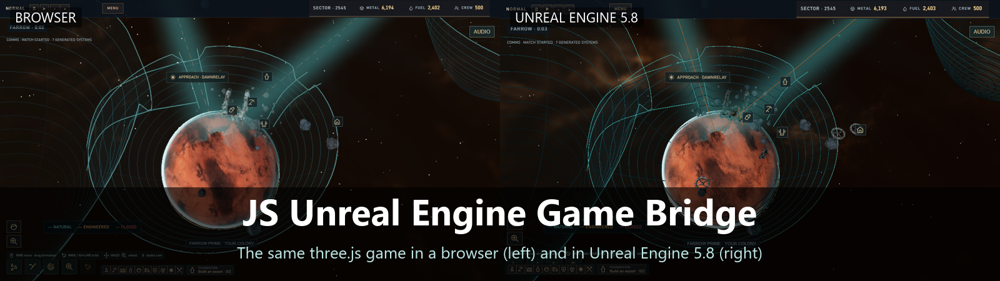
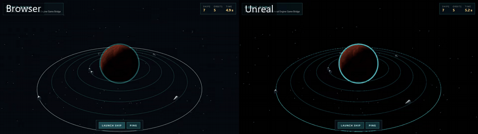
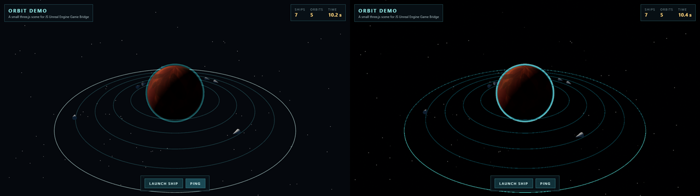
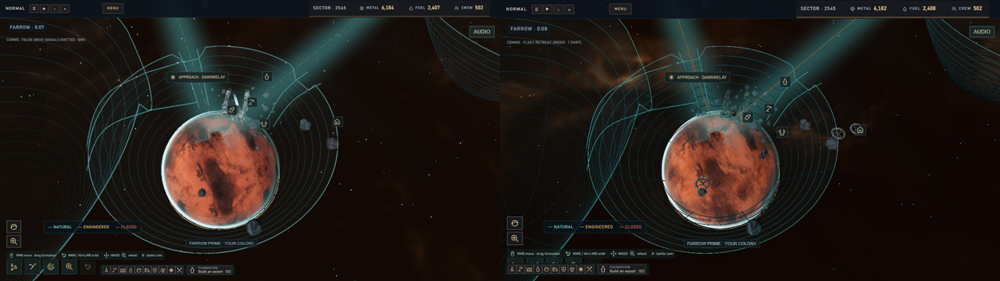
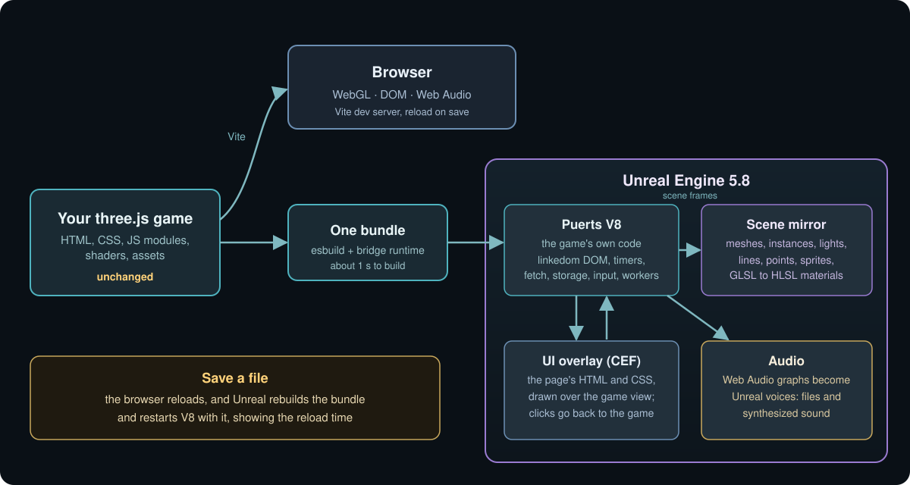
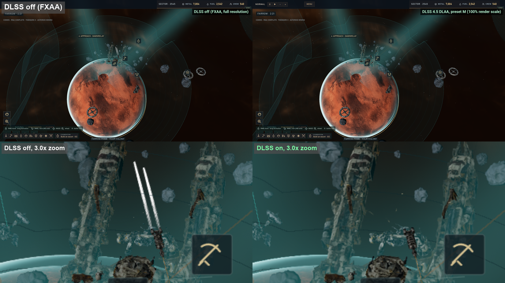

<p align="center">
  
</p>

<h1 align="center">JS Unreal Engine Game Bridge</h1>

<p align="center">
  Run an unchanged three.js browser game inside Unreal Engine 5.8.<br>
  Build and test on the web in seconds. Ship it with Unreal and NVIDIA DLSS.
</p>

<p align="center">
  <a href="https://github.com/andrsnn/js-unreal-engine-game-bridge/actions/workflows/ci.yml"></a>
</p>

<p align="center">
  
</p>

## What it is

JS Unreal Engine Game Bridge takes a three.js game written for the browser and runs it inside
Unreal Engine 5.8 without changing the game. The game's own JavaScript runs in V8 through Puerts.
Its three.js scene is copied into Unreal meshes, lights and materials every frame. Its HTML and CSS
draw on top through Unreal's built-in Chromium (CEF), and its Web Audio plays through Unreal's audio
engine.

You keep writing one game for the web. Save a file and it reloads in the browser and in Unreal, and
each one shows how long the reload took.

## Why this matters

- **Build fast on the web.** A web game reloads in about a second. You keep that speed while the same
  game also runs in Unreal.
- **Ship with Unreal.** The same game gets Unreal's renderer, post processing, packaging and platforms.
  You can swap in Unreal meshes, materials and Niagara effects one asset at a time.
- **NVIDIA DLSS for a three.js game.** One flag turns on DLSS 4.5 Super Resolution, DLAA or Frame
  Generation. The game itself doesn't change.
- **One codebase.** There's no port to maintain. Gameplay, UI and sound stay in the web project.
- **Made for AI-driven development.** An AI agent works well in a web codebase: it can read every
  file, run the game in a headless browser, take screenshots and fix what it sees in seconds. In an
  Unreal project, a lot of the game lives in binary assets and Blueprints. With the bridge, the agent
  keeps working on the web, and a conformance test films the browser and Unreal side by side from the
  same commit, so the agent can check the Unreal build without ever opening Unreal itself.

## Side by side

| Orbit demo (included) | Hard Burn (a larger private game) |
| --- | --- |
|  |  |

In each image the browser is on the left and Unreal is on the right, built from the same commit.

## How it works

<p align="center">
  
</p>

1. **One bundle.** esbuild builds the game with the bridge runtime into one script, in about a second.
   three.js is swapped for a stand-in renderer that records the scene instead of drawing it.
2. **Browser APIs in V8.** linkedom provides the DOM. The runtime adds `window`, timers,
   `requestAnimationFrame`, `fetch` for the game's files, `localStorage`, keyboard, mouse and gamepad
   input, canvas 2D with real text, Web Workers, Web Audio, and an en-US `Intl`.
3. **Scene mirror.** Each frame, the camera, lights, fog, meshes, instances, lines, points and sprites
   go to Unreal as one float array. Geometry, textures and materials go once and again only when they
   change. Custom `ShaderMaterial` GLSL is compiled to HLSL (glslang and SPIRV-Cross, built to
   WebAssembly) and becomes an Unreal material.
4. **UI overlay.** The page's body and stylesheets render in a transparent CEF browser over the game
   view. Clicks and key presses go back to the game's own handlers.
5. **Audio.** Web Audio graphs become Unreal voices, from sound files or synthesized sound.

## Features

| Area | Supported | Notes |
| --- | :---: | --- |
| Meshes, groups, instanced meshes | ✅ | Built in the frame they first appear |
| Standard, Phong, Lambert, Basic materials | ✅ | Color, maps, emissive, roughness, metalness, transparency |
| Custom `ShaderMaterial` and `RawShaderMaterial` | ✅ | GLSL to HLSL at run time (editor builds) |
| Lines, line loops, line segments | ✅ | Drawn in three.js order |
| Thick lines (`Line2`) and dashed lines | ✅ | Width in pixels or world units |
| Points and sprites | ✅ | Camera-facing billboards, world or pixel size |
| Skinned meshes and morph targets | ✅ | Deformed on the CPU each frame |
| Render targets | ✅ | Unreal draws a render target's scene with a scene capture |
| `onBeforeCompile` material patches | ✅ | Translated to Unreal materials (editor builds) |
| Lights, fog, background, tone mapping, bloom | ✅ | |
| HTML and CSS UI | ✅ | CEF overlay, clicks and keys go to the game |
| Canvas 2D (including text) | ✅ | FreeType text with the game's fonts |
| Web Audio and `<audio>` | ✅ | Gain, pitch, pan, 3D position, low-pass |
| Web Workers | ✅ | Each worker runs on its own thread. Results are cached between launches |
| `localStorage`, `fetch`, timers, input, gamepads | ✅ | |
| Hot reload with timings | ✅ | Build plus restart, shown on screen. A CSS-only save updates the UI without a restart |
| NVIDIA DLSS 4.5 (Super Resolution, DLAA, Frame Generation) | ✅ | Needs an RTX GPU and NVIDIA's plugin. Other GPUs get Unreal's TSR |
| Browser and Unreal conformance suite | ✅ | 23 feature tests and 3 games, see [Conformance suite](#conformance-suite) |
| Custom `EffectComposer` passes | ❌ | `UnrealBloomPass`, fog, tone mapping and exposure only |
| WebGPU and TSL node materials | ❌ | Drawn with generic materials |
| Packaged (shipping) builds | ⚠️ | Custom shaders need an editor build, or a registry material |

## Quick start

You need Windows, [Unreal Engine 5.8](https://www.unrealengine.com/) with Visual Studio 2022 set up for
C++, [Node.js 22](https://nodejs.org/) and [Git](https://git-scm.com/).

1. **Make a host project.** In the Unreal 5.8 editor, create a new project from **Games > Blank** with
   **C++** selected, for example `GameHost`. Close the editor when it opens.
2. **Add Puerts.** Puerts' 1.0.9 release doesn't build on Unreal 5.8 yet, so take its source from
   GitHub at the commit the bridge is tested with, and the V8 libraries from the 1.0.9 release:

   ```
   git clone https://github.com/Tencent/puerts.git
   cd puerts
   git checkout 83aea66daf17507768746ca31e81c6bd818a4967
   ```

   Copy `puerts/unreal/Puerts` to `GameHost/Plugins/Puerts`. Then download `puerts_v8_94.tgz` from the
   [Unreal_v1.0.9 release](https://github.com/Tencent/puerts/releases/tag/Unreal_v1.0.9), unpack it, and
   copy its `Puerts/ThirdParty/v8_9.4.146.24` folder to `GameHost/Plugins/Puerts/ThirdParty`.
3. **Add the bridge and patch Puerts.** In `GameHost/Plugins`:

   ```
   git clone https://github.com/andrsnn/js-unreal-engine-game-bridge.git JsGameBridge
   cd Puerts
   git apply ../JsGameBridge/Patches/puerts-thread-safe.patch
   ```

   The patch builds Puerts thread-safe, so the game's JavaScript can run on its own thread
   (`--js-thread`), which is how the frame rates under Performance were measured. Without it the bridge
   still works and runs the JavaScript on Unreal's game thread.
4. **Build the editor.** From a command prompt, with your own paths:

   ```
   "C:\Program Files\Epic Games\UE_5.8\Engine\Build\BatchFiles\Build.bat" GameHostEditor Win64 Development -Project="C:\Projects\GameHost\GameHost.uproject" -WaitMutex
   ```

5. **Install the tools.**

   ```
   cd GameHost/Plugins/JsGameBridge/Runtime
   npm install
   cd ../Examples/orbit-demo
   npm install
   ```

6. **Tell the tools where Unreal is.** In `Plugins/JsGameBridge`, copy `jsgb.local.example.json` to
   `jsgb.local.json` and set `engine` (UnrealEditor.exe) and `project` (your host `.uproject`).
7. **Play.** Double-click `Play in Browser.cmd`, then `Play in Unreal.cmd`. Both open the orbit demo.
   To run the game's JavaScript on its own thread, run `npm run unreal -- orbit-demo --js-thread`.
8. **DLSS (optional).** With an NVIDIA RTX GPU, follow [NVIDIA DLSS](#nvidia-dlss) and double-click
   `Play in Unreal (DLSS).cmd`.
9. **Live edit.** Double-click `Demo/Add Feature.cmd`. It adds a label to the demo's HUD, and both
   windows reload. `Demo/Remove Feature.cmd` takes it out again.

## Performance

Frame rates in Unreal, measured on a Windows PC with an RTX 4090: Unreal 5.8 editor build (`-game`),
2560×1440, DLSS off, frame generation off, and the game's JavaScript on its own thread (`--js-thread`).

| Game and view | Average | 1% low | Slowest frame |
| --- | --- | --- | --- |
| Hard Burn, starting view | 157 FPS | 64 FPS | 45 FPS (22 ms) |
| Hard Burn, a campaign sector | 187 FPS | 107 FPS | 80 FPS |
| A second private game, on a planet | 215 FPS | 115 FPS | 74 FPS |

Every frame in these runs is faster than 60 FPS except one 22 ms frame on Hard Burn's starting view.

Build and reload times, at 1280×720:

| | Orbit demo | Hard Burn |
| --- | --- | --- |
| Bundle build | 0.5 s | 0.6 s |
| Hot reload in Unreal (save to first frame) | 0.6 s | 13 to 18 s |
| Page reload in the browser (to first frame) | 0.1 to 0.6 s | about 4 s |

Most of a large game's reload time is the game's own loading.

## Conformance suite

`npm run suite` plays the same script in Chrome and in Unreal from the same commit, with a fixed game clock,
and compares the frames. It runs 23 small three.js scenes, one per feature (materials, textures, KTX2,
transparency, lines, billboards, shadows, fog, instancing, skinning, glTF, post-processing, shader patches,
UI, input, timers, audio and more), and three games: the orbit demo and two official three.js examples.

A run passes when the pictures match (SSIM at least 0.9 and at most 2.5% of pixels clearly different for
a feature test; SSIM 0.7 and 20% for a game), Unreal draws at least the objects the browser drew on every
frame after loading, and neither side reports a JavaScript error.

On version 0.3.0, 25 of the 26 runs pass. The transparency test is the exception: WebGL blends
transparent surfaces using sRGB values and Unreal blends them in linear light, so a transparent color over
a dark background comes out brighter in Unreal. The full report, with a side-by-side image of every run,
is in [docs/conformance/README.md](docs/conformance/README.md).

To run it, install the suite's packages and headless Chromium once, then run the suite:

```
cd Tests/suite
npm install
npx playwright install chromium
cd ../..
npm run suite
```

To check one game, run `npm run conformance -- orbit-demo`. `npm run ci` builds the host editor first and
exits with the suite's result.

GitHub Actions runs the checks that don't need Unreal on every push and pull request: `npm run lint`,
`npm test` (unit tests), the fake-DOM boot of the example games, and the browser half of the suite in
headless Chromium (`node Tools/suite.mjs --web-only`). The Unreal half runs every night on a Windows PC
with an RTX GPU.

## NVIDIA DLSS

The bridge draws the game with Unreal's renderer, so a three.js game can use NVIDIA DLSS 4.5 with no
change to the game.

<p align="center">
  
</p>

1. Download the DLSS plugin for Unreal Engine 5.8 from [NVIDIA](https://developer.nvidia.com/rtx/dlss)
   and accept NVIDIA's license. This repository doesn't include the plugin, because it's covered by
   NVIDIA's RTX SDK license, not by this project's MIT license.
2. Copy `DLSS`, `StreamlineCore`, `StreamlineNGXCommon`, `StreamlineDLSSG`, `StreamlineReflex` and
   `StreamlineDeepDVC` from the download's `Plugins` folder into your host project's `Plugins` folder.
3. Enable `DLSS`, `StreamlineDLSSG`, `StreamlineReflex` and `StreamlineDeepDVC` in the host
   `.uproject`, then build the editor target again.
4. Double-click `Play in Unreal (DLSS).cmd`, or pass these flags to `npm run unreal` or
   `Tools/run-unreal.mjs`:

| Flag | What it does |
| --- | --- |
| `--dlss dlaa` | DLAA: NVIDIA's AI anti-aliasing at full resolution |
| `--dlss quality` (or `balanced`, `performance`, `ultra`) | DLSS Super Resolution: renders at 67% (58%, 50%, 33%) and upscales |
| `--dlss 5` | DLSS 5 Neural Rendering when it's available, and DLAA until then (see below) |
| `--frame-gen` | DLSS Frame Generation, on RTX 40 series and later. Needs a visible window and Windows hardware-accelerated GPU scheduling |
| `--vibrance 0.5` | RTX Dynamic Vibrance |
| `--tsr 67` | Unreal's TSR at 67%, on any GPU |
| `--hud` | Shows the mode and the frame rate on screen |

Every DLSS mode uses DLSS 4.5's second-generation transformer model (preset M). Without an NVIDIA RTX
GPU or the plugin, `--dlss` uses TSR at the same render scale instead.

On an RTX 4090 at 4K, a larger private test game runs at 65 FPS with FXAA, 64 FPS with DLSS Performance and
59 FPS with DLAA. Both test games are limited by their JavaScript on the CPU, not by the GPU, so DLSS doesn't
raise their frame rate. It gives cleaner edges and finer detail at about the same frame rate. DLSS
Super Resolution raises the frame rate when the GPU is the limit.

DLSS 5 Neural Rendering is waiting on NVIDIA. It needs an RTX 50 series GPU, driver 616.64 or newer, and a
DLSS plugin for Unreal that includes it, and NVIDIA hasn't released that plugin to developers yet.
`--dlss 5` checks all three when the game starts, writes what's missing to the log (and on screen with `--hud`),
and uses DLSS 4.5 DLAA instead. Nothing in this repository needs to change when NVIDIA's plugin comes out.

## Port your own game

Most games need one config file. Plan on under an hour.

1. Add `Games/<name>.json`. Paths are relative to this repository:

   ```json
   {
     "title": "My Game",
     "repo": "../my-game",
     "index": "index.html",
     "public": ["public"]
   }
   ```

2. Run `node Tools/jsgb.mjs smoke <name>`. It boots the game in Node with the same browser APIs as
   Unreal and reports missing files, errors and what the scene contains. Fix those first.
3. Run `npm run unreal -- <name>`. It builds, starts Unreal, and reloads on every save.
4. Write `Tests/scripts/<name>.txt` and run `npm run conformance -- <name>` to film the browser and
   Unreal side by side and check every frame.

A conformance script has one step per line, in seconds after the game starts:

```
0 wait 'NEW GAME'      wait until an element with this text (or CSS selector) exists
1 gone #loading        wait until an element no longer exists
1 objects 500          wait until the scene draws at least 500 objects
2 shot title           save a screenshot
3 click 'NEW GAME'     click it
5 key Escape           press a key
20 quit
```

## Known limits

- Generated shader materials need an editor build of the host (`UnrealEditor -game`). In a packaged
  game they fall back to generic materials unless the registry supplies one.
- Loading is slower than in a browser, because V8 in Puerts (9.4) is older than Chrome's. Some Web Worker
  code runs up to 8 times slower than in Chrome. Worker results are cached on disk, so later launches are
  faster.
- The UI overlay (CEF) can take 56 to 100 ms in a single frame right after a game loads, while the page
  lays out for the first time.
- Plain lines are one pixel wide, as in WebGL, and have no antialiasing.
- Transparent surfaces blend in linear light, so they come out brighter over dark backgrounds than in
  WebGL.
- Canvases drawn by a second renderer (minimaps, previews) show as empty in the overlay.
- Web Audio effect nodes other than gain, pan and low-pass (delay, convolver, compressor) are skipped.
- Windows only for now.

## Roadmap

- Packaged builds with shader materials cooked ahead of time.
- Antialiased lines.
- A newer V8 in Puerts, for faster loading.
- Custom post-processing passes.
- DLSS 5 Neural Rendering, once NVIDIA releases it for Unreal (it needs an RTX 50 series GPU).
- Faster UI overlay start-up, so no frame takes longer than 16.7 ms.
- macOS and Linux hosts.

## Contributing

See [CONTRIBUTING.md](CONTRIBUTING.md). Changes are listed in [CHANGELOG.md](CHANGELOG.md).

## License

MIT. See [LICENSE](LICENSE). The vendored shader compiler in `Runtime/vendor/cross-shader` keeps its
own MIT license.
