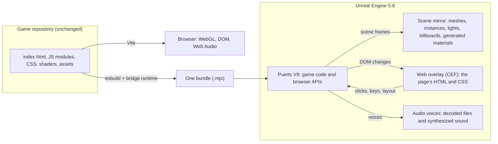

# JsGameBridge

JsGameBridge runs a Three.js browser game inside Unreal Engine 5 without changing the game. You keep
writing the game for the web. The bridge builds the same source into one script for Unreal, runs it
in V8 through Puerts, and copies the Three.js scene into Unreal meshes, materials and lights every
frame. The
page's HTML and CSS show up as an overlay, and Web Audio plays through Unreal's audio engine.

When you save a file, the browser and Unreal both reload, and each one shows how long the reload
took.

## Try it

You need Windows, Unreal Engine 5.8, Node 22 and a host project (see Setup).

1. Double-click `Play in Browser.cmd`. The demo game opens in your browser.
2. Double-click `Play in Unreal.cmd`. The same game starts in an Unreal window.
3. Double-click `Demo/Add Feature.cmd`. It adds a small HUD label to the game's source. The browser
   reloads, then Unreal reloads, and each one shows how long the reload took.
4. Double-click `Demo/Remove Feature.cmd` to take it out again.

The demo works on a private copy of the game made by `node Tools/demo.mjs prepare`, so the game's own
repository never changes.

## How it works



The pieces:

- **Browser APIs** (`Runtime/src`). A DOM from linkedom, `window`, timers and
  `requestAnimationFrame`, `fetch` for files in the build, `localStorage`, keyboard, mouse and
  gamepad input, canvas 2D with real text, Web Workers, Web Audio, and an en-US `Intl` for number
  and date formatting (Puerts' V8 has no `Intl`).
- **Renderer stand-in.** The bundle swaps `THREE.WebGLRenderer` for a renderer that records the scene
  instead of drawing it. Each frame it sends the camera, lights, fog, meshes, instances, points,
  lines and sprites to Unreal as one float array. Geometry, textures and materials are sent once, then
  again only when they change.
- **Custom shaders.** `ShaderMaterial` GLSL is compiled to HLSL with glslang and SPIRV-Cross (built to
  WebAssembly), and the host builds an Unreal material from it for both the vertex and pixel stages. Bloom, fog,
  tone mapping and exposure map to Unreal post processing.
- **UI overlay.** The page's body and stylesheets render in a transparent browser over the game view.
  Clicks and key presses go back to the game's own handlers.
- **Hot reload.** `Tools/jsgb.mjs` rebuilds the bundle in about a second and asks the running host to
  restart V8 with it. Compiled shaders and results from game workers are kept across reloads.
- **Asset swaps (optional).** A registry can map a game's model or effect keys to Unreal meshes,
  materials and Niagara systems. They are off unless a game turns them on.

## Setup

1. Make an Unreal 5.8 C++ project to host games. Add [Puerts](https://github.com/Tencent/puerts) and
   this repository as plugins (`Plugins/Puerts`, `Plugins/JsGameBridge`).
2. Run the browser setup once, before the first build. The build stops and tells you to run it if you
   haven't:

   ```
   powershell -ExecutionPolicy Bypass -File Plugins\JsGameBridge\Tools\setup-cef152.ps1
   ```

   Games draw their page and menus with Chromium 152 (CEF 152), not the Chromium 128 that ships with
   Unreal 5.8. Pages ran 15 to 26 percent faster on it in our tests. The script copies Unreal's `WebBrowser` and
   `CEF3Utils` modules from your own engine install into `Source/`, makes the bridge's changes to
   them, and downloads CEF 152 from the official CEF builds (cef-builds.spotifycdn.com). This
   repository never holds Epic's source. The script finds the engine through the Epic Games Launcher.
   Pass `-EngineDir "C:\Program Files\Epic Games\UE_5.8"` if it can't. You need Visual Studio with
   "Desktop development with C++" (it includes CMake and Ninja).
3. Build the editor target.
4. Run `npm install` in `Runtime/`.
5. Create `jsgb.local.json` in this folder:

   ```json
   {
     "engine": "C:/Program Files/Epic Games/UE_5.8/Engine/Binaries/Win64/UnrealEditor.exe",
     "project": "C:/Projects/GameHost/GameHost.uproject",
     "builds": "Builds"
   }
   ```

   `JSGB_ENGINE`, `JSGB_PROJECT` and `JSGB_BUILDS` override these.
6. Run `npm install` in the game's own folder. The bridge uses the game's Vite for the browser side,
   and the game's Playwright for the conformance test.
7. Install FFmpeg if you want side-by-side films from the conformance test.

## Port a game

Most games need only a config file. Plan on under an hour.

1. Add `Games/<name>.json`:

   ```json
   {
     "title": "My Game",
     "repo": "../my-game",
     "index": "index.html",
     "public": ["public"]
   }
   ```

   Optional keys: `search` (the query string the game boots with), `env` and `define` (build
   constants), `registry` and `swaps` (Unreal asset swaps), `audioCues`, and `conformanceSearch`.
2. Run `node Tools/jsgb.mjs smoke <name>`. It boots the game in Node with the same browser APIs as
   Unreal and prints missing files, errors and what the scene contains. Fix anything it reports
   before you open Unreal.
3. Run `npm run unreal -- <name>`. It builds the game, starts Unreal, and reloads on every save.
4. Write `Tests/scripts/<name>.txt` and run `npm run conformance -- <name>` (see below).

A port may still need:

- A file the game loads in a way the build can't see (a path built at run time). Put it in a public
  folder.
- A shader that doesn't translate. The log names it, and it draws with a generic material. A registry
  material can replace it.
- A query string or seed so both targets build the same world for the conformance test.

## Display settings

A game's options menu can change the Unreal window through `window.jsgb.display`. In a browser the object doesn't
exist, so check for it first.

```js
if (window.jsgb?.display?.supported) {
  const modes = jsgb.display.modes();        // [{width: 2560, height: 1440, refresh: 165}, ...] the monitor supports
  const now = jsgb.display.get();            // {width, height, mode: 'windowed' | 'borderless' | 'fullscreen', vsync, maxFps}
  await jsgb.display.set({width: 1920, height: 1080, mode: 'windowed', vsync: false, maxFps: 0});  // 0: no frame cap
}
```

Each field of `set` is optional. A change resizes the window, so the game gets a `resize` event and new
`innerWidth` and `innerHeight`, as in a browser. The standard Fullscreen API works too: `element.requestFullscreen()`
switches to borderless fullscreen, `document.exitFullscreen()` returns to the window, and `document.fullscreenElement`
and the `fullscreenchange` event behave as in a browser. Unreal saves the settings, so the next launch starts with them.

## Conformance test

`npm run conformance -- <name>` builds the browser and Unreal targets from the same commit, runs the
same script in headless Chrome and in Unreal, and writes a side-by-side film and stills. A script is
one step per line, in seconds after the game starts:

```
0 wait 'NEW GAME'      wait until an element with this text (or CSS selector) exists
0 gone #loading        wait until an element no longer exists
1 shot title           save a screenshot
3 click 'NEW GAME'     click it
5 key Escape           press a key
6 seed 1234            reseed Math.random at the next click on both sides
20 quit
```

Pairs of frames line up at each `wait` and `gone`, so a slower load on one side doesn't shift the film.

## Commands

| Command | What it does |
| --- | --- |
| `npm run unreal -- <game>` | Build, start Unreal or reload it, then reload on every save |
| `npm run web -- <game>` | The game's Vite dev server with a reload timer |
| `node Tools/jsgb.mjs build <game>` | Build the Unreal bundle only |
| `node Tools/jsgb.mjs smoke <game>` | Boot the bundle in Node and report problems |
| `npm run conformance -- <game>` | Browser and Unreal side by side from one commit |
| `node Tools/run-unreal.mjs <game> --offscreen --script s.txt --capture dir` | Scripted Unreal run with frame capture |

## Why this helps when an AI writes the game

An AI agent works well in a web codebase. It can read every file, run the game in a headless
browser, take screenshots and fix what it sees in seconds. In an Unreal project much of the game
lives in binary assets and Blueprints, and every check needs the editor.

With the bridge, the agent keeps working in the web project, and Unreal is one more build target.
The conformance test gives it a film of the browser and Unreal side by side from the same commit, so
it can check the Unreal version without opening Unreal itself.

## Limits

- Generated shader materials need an editor build of the host (`UnrealEditor -game`). In a packaged
  game they fall back to generic materials unless the registry supplies one.
- Loading is slower than in the browser. Workers run on the game thread, and V8 in Puerts is older
  than Chrome's. Hard Burn's first frame after a reload takes about 15 seconds in Unreal and about 4
  in the browser.
- Custom post-processing passes (your own `EffectComposer` passes) are not translated. Bloom, fog,
  tone mapping and exposure are.
- Canvases that a second renderer draws into the page (minimaps, previews) show as empty in the
  overlay.
- Web Audio sources play with their gain, pitch, pan, 3D position and low-pass cutoff. Other effect
  nodes (delay, convolver, compressor) are skipped.
- Line width is always one pixel, as in most WebGL browsers.
- Windows only for now.

## License

MIT. See [LICENSE](LICENSE). The vendored shader compiler in `Runtime/vendor/cross-shader` keeps its
own license. The `WebBrowserCef` and `CEF3UtilsCef` folders that `Tools/setup-cef152.ps1` makes are
copies of Epic's code from your own engine install, under your Unreal Engine EULA. Don't commit them.
CEF and Chromium are BSD-licensed. Their notices ship next to `libcef.dll` (`CEF-LICENSE.txt`,
`CEF-CREDITS.html`).
