# Conformance results

Version 0.3.0, measured 2026-10-11 16:24 UTC. 25 of 26 passed.

Each run plays the same script in Chrome and in Unreal from the same commit, with a fixed game clock, and compares
the paired frames. A case passes when the pictures match (SSIM at least 0.9 and at most 2.5% of pixels clearly different for test
cases; SSIM 0.7 and 20% for games), every
Unreal frame after the game finishes loading draws at least what the browser drew, and neither side reports a JavaScript error.

| Run | Result | SSIM (mean, lowest) | Pixels differing % (mean, worst) | PSNR dB | Coverage | Errors (browser, Unreal) | JS ms/frame in Unreal | Unreal memory MB | Chrome JS heap MB | Notes |
| --- | --- | --- | --- | --- | --- | --- | --- | --- | --- | --- |
| basics | pass | 0.997, 0.996 | 0.72, 0.72 | 42.3 | ok | 0, 0 | 613.56 | 3405 | 9.5 |  |
| materials | pass | 0.988, 0.988 | 2.17, 2.17 | 34.8 | ok | 0, 0 | 8.92 | 2906 | 9.5 |  |
| textures | pass | 1, 1 | 0, 0 | 49.8 | ok | 0, 0 | 483.62 | 3298 | 9.5 |  |
| ktx2 | pass | 0.999, 0.999 | 0, 0 | 51.5 | ok | 0, 0 | 11.65 | 2917 | 9.5 |  |
| transparency | FAIL | 0.994, 0.994 | 7.26, 7.29 | 33.3 | ok | 0, 0 | 0 | 2804 | 9.5 | 7.26% of pixels differ (limit 2.5%) |
| lines | pass | 0.992, 0.992 | 0.58, 0.58 | 36.7 | ok | 0, 0 | 0 | 2793 | 9.5 |  |
| billboards | pass | 0.973, 0.973 | 2.07, 2.08 | 28.1 | ok | 0, 0 | 0 | 2802 | 9.5 |  |
| shadows | pass | 0.997, 0.997 | 0, 0 | 47 | ok | 0, 0 | 9.69 | 2923 | 9.5 |  |
| fog | pass | 0.999, 0.999 | 0, 0 | 47.7 | ok | 0, 0 | 7.57 | 2878 | 9.5 |  |
| fogExp2 | pass | 0.999, 0.999 | 0, 0 | 48.1 | ok | 0, 0 | 0 | 2810 | 9.5 |  |
| ortho | pass | 0.998, 0.998 | 0, 0 | 42 | ok | 0, 0 | 13.61 | 2924 | 10.1 |  |
| instances | pass | 0.975, 0.975 | 0, 0 | 41.5 | ok | 0, 0 | 0 | 2813 | 9.5 |  |
| batched | pass | 0.999, 0.998 | 0, 0 | 48.1 | ok | 0, 0 | 6.66 | 2914 | 9.5 |  |
| churn | pass | 0.998, 0.997 | 0.1, 0.21 | 49.3 | ok | 0, 0 | 8.68 | 2887 | 9.5 |  |
| motion | pass | 0.99, 0.976 | 0.59, 1.47 | 46.3 | ok | 0, 0 | 0 | 2816 | 9.5 |  |
| skinning | pass | 0.999, 0.998 | 0.03, 0.07 | 50.7 | ok | 0, 0 | 16.29 | 2889 | 9.5 |  |
| gltf | pass | 0.998, 0.996 | 0.1, 0.21 | 50 | ok | 0, 0 | 6.28 | 2899 | 9.5 |  |
| postprocess | pass | 0.995, 0.995 | 0.15, 0.23 | 41.3 | ok | 0, 0 | 0 | 2812 | 9.5 |  |
| hooks | pass | 0.998, 0.997 | 0, 0 | 47.8 | ok | 0, 0 | 0 | 2827 | 9.5 |  |
| ui | pass | 0.997, 0.997 | 0.44, 0.45 | 34 | ok | 0, 0 | 25.56 | 2896 | 9.5 |  |
| input | pass | 1, 1 | 0, 0.01 | 57.6 | ok | 0, 0 | 6.19 | 2893 | 9.5 |  |
| timers | pass | 0.994, 0.969 | 1.3, 6.41 | 45.4 | ok | 0, 0 | 0 | 2808 | 9.5 |  |
| audio | pass | 1, 0.998 | 0.01, 0.08 | 53.8 | ok | 0, 0 | 0 | 2810 | 9.5 |  |
| orbit-demo | pass | 0.975, 0.974 | 0.53, 0.56 | 33.5 | ok | 0, 0 | 0 | 2810 | 9.5 |  |
| threejs-fps | pass | 0.953, 0.854 | 0.49, 2.48 | 31.1 | ok | 0, 0 | 0 | 2859 | 9.5 |  |
| threejs-pointerlock | pass | 0.993, 0.993 | 0, 0 | 38.1 | ok | 0, 0 | 0 | 2826 | 17.4 |  |

## Known differences

- **transparency**: WebGL blends transparent surfaces using sRGB values, and Unreal blends them in linear light. Over a dark background a transparent colour comes out brighter in Unreal, and over a light one darker. No single change to opacity matches both.

## Side by side (browser left, Unreal right)

### basics

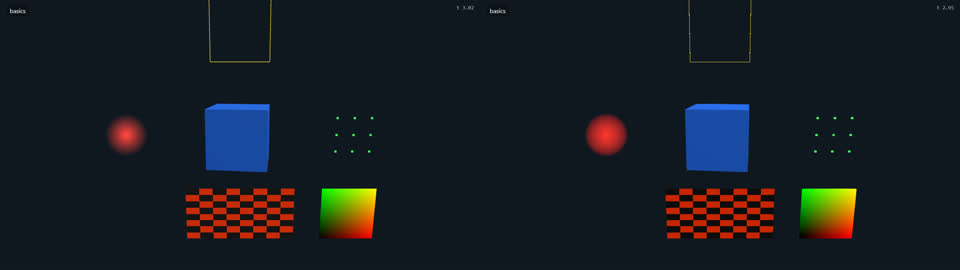

### materials

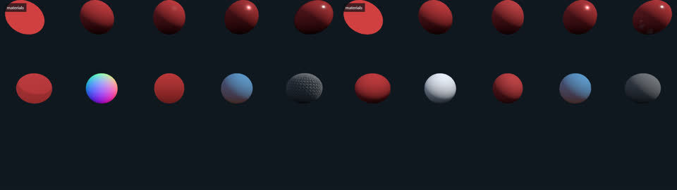

### textures

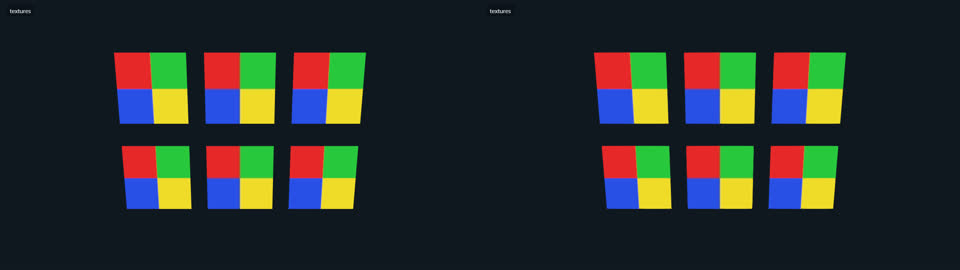

### ktx2

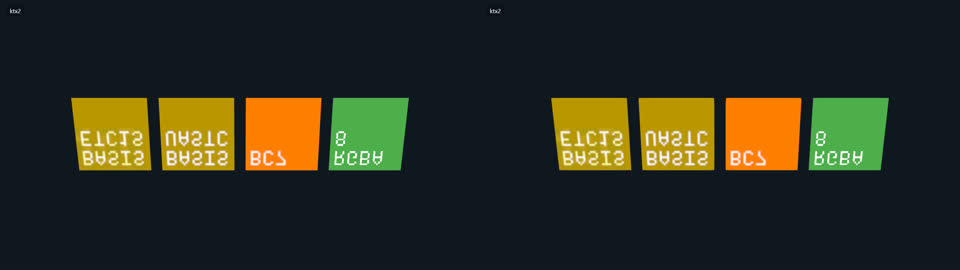

### transparency

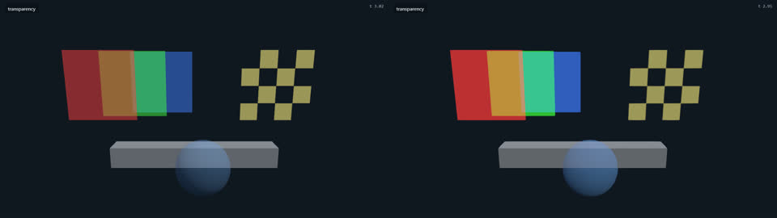

### lines

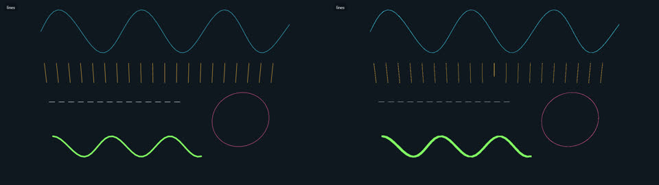

### billboards

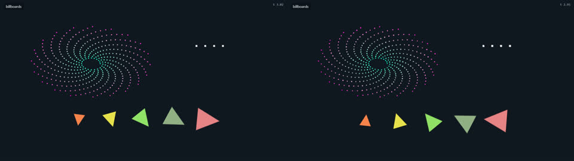

### shadows

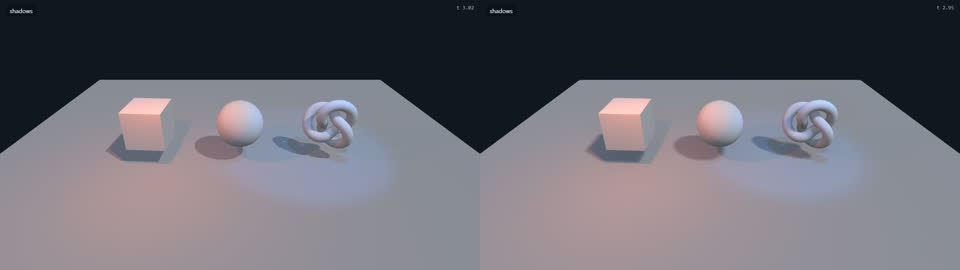

### fog

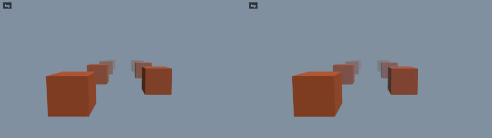

### fogExp2

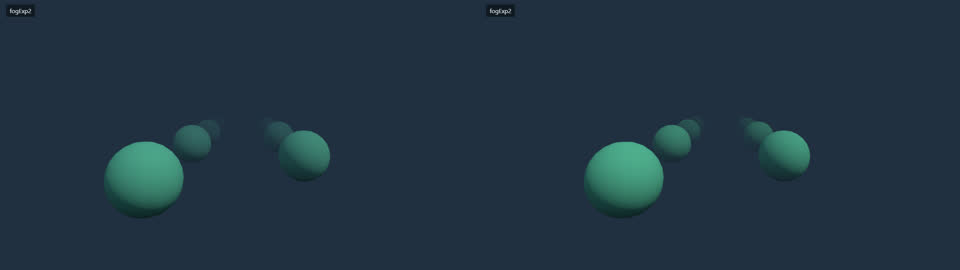

### ortho

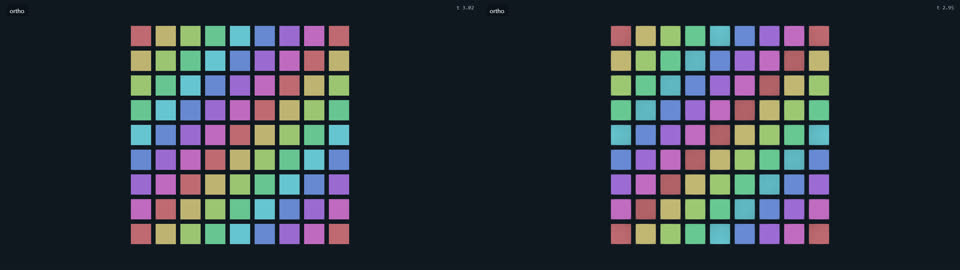

### instances

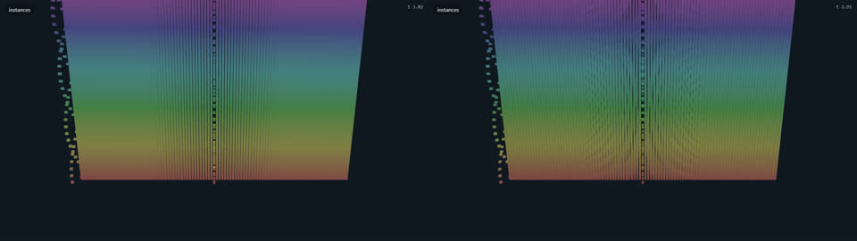

### batched

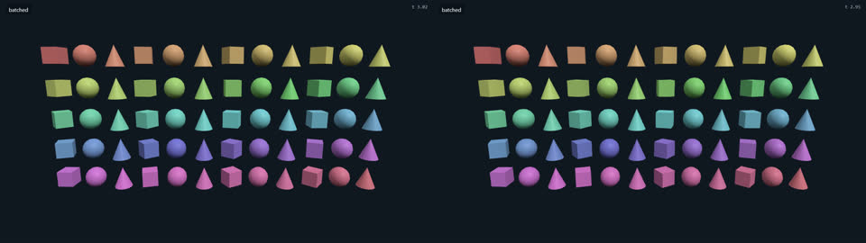

### churn

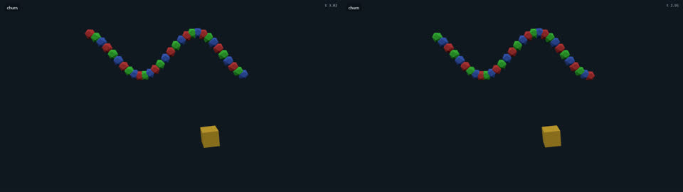

### motion

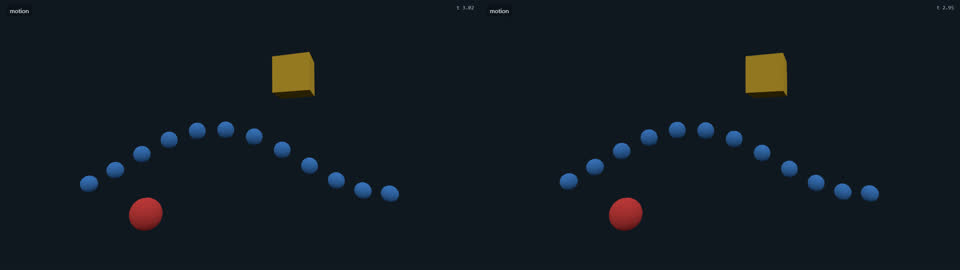

### skinning

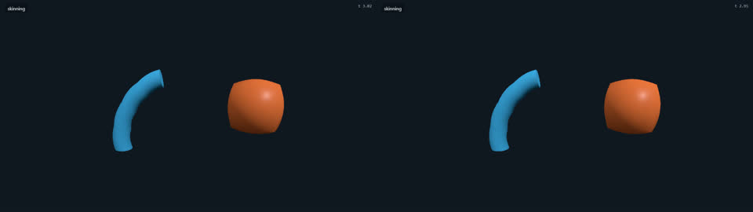

### gltf

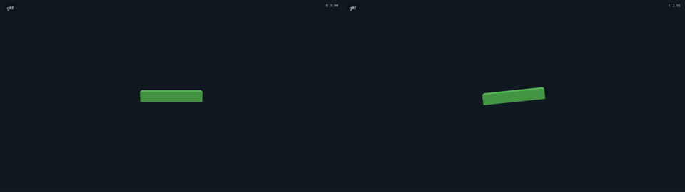

### postprocess

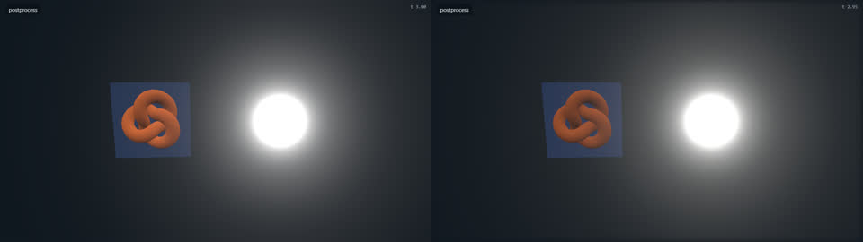

### hooks

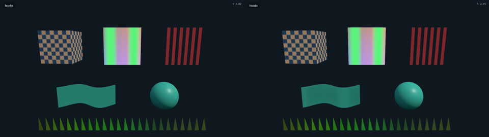

### ui

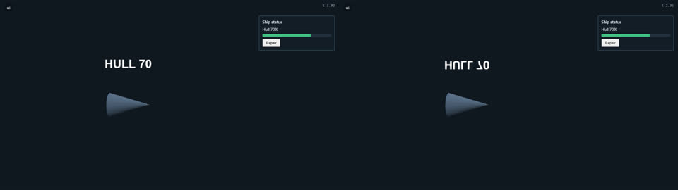

### input

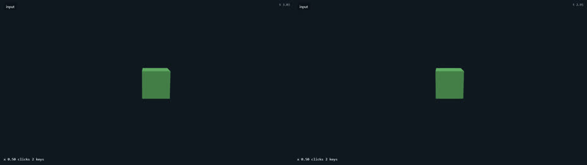

### timers

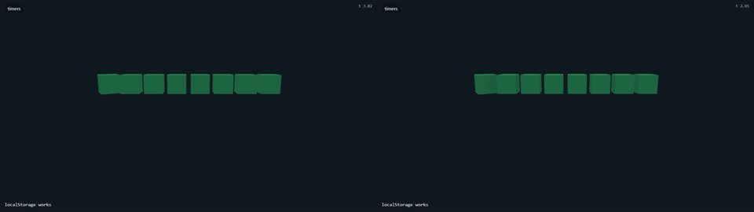

### audio

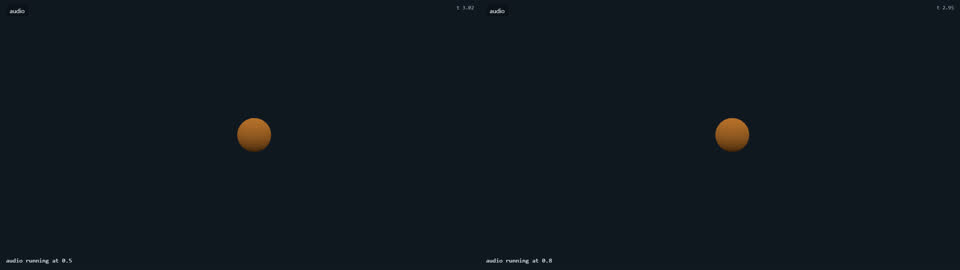

### orbit-demo

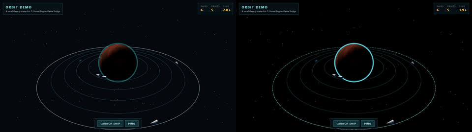

### threejs-fps

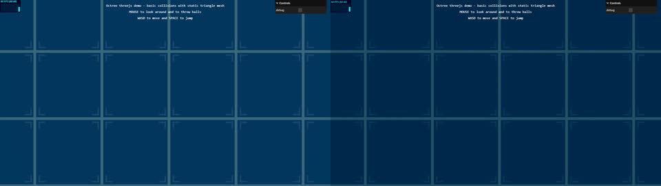

### threejs-pointerlock

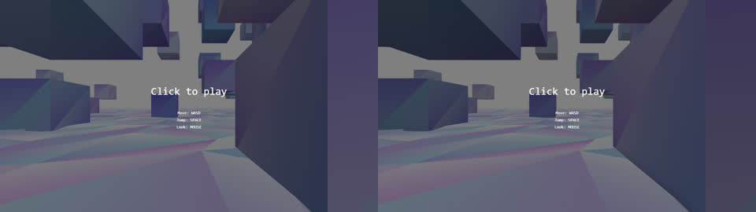
